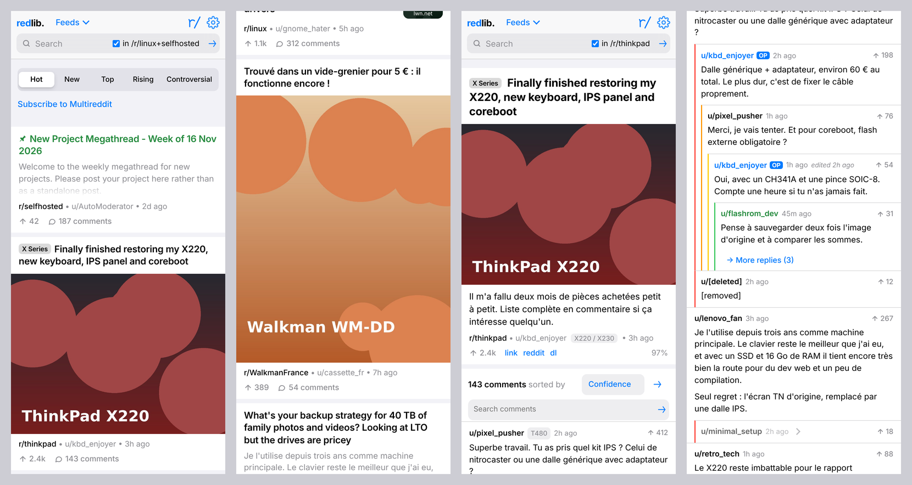

# redlib-voyager

Le fork de Redlib par [Nachtalb](https://github.com/Nachtalb/redlib), avec un thème clair « voyager » inspiré de [Voyager](https://github.com/aeharding/voyager) : grandes cartes, police système, contrôles à la iOS, commentaires avec une barre de couleur par niveau.



Le thème est un seul fichier CSS, `voyager.css`. Redlib intègre ses thèmes au binaire. Il faut donc le recompiler, ce que fait la GitHub Action de ce dépôt.

## Mise en place

1. **Créer le dépôt.** Créez un dépôt GitHub (public ou privé) et ajoutez-y tous les fichiers de ce dossier, y compris `.github/workflows/build.yml`. Le dépôt ne contient aucun secret.
2. **Lancer le premier build.** Allez dans *Actions*, puis *Build redlib-voyager*, puis *Run workflow*. Le premier build prend environ 20 à 40 minutes, car il compile Redlib pour amd64 et arm64. Pour ne compiler que l'architecture de votre serveur, ajoutez une variable de dépôt `PLATFORMS` (*Settings → Secrets and variables → Actions → Variables*) :
   - `linux/amd64` pour un PC ou un NAS Intel/AMD ;
   - `linux/arm64` pour un Raspberry Pi 4 ou 5 en 64 bits.
3. **Mises à jour automatiques.** L'Action vérifie chaque jour si Nachtalb a publié des changements et ne recompile que dans ce cas. Elle recompile aussi quand vous modifiez `voyager.css`.
4. **Visibilité de l'image.** L'image est publiée sur `ghcr.io/<votre-utilisateur>/<nom-du-dépôt>:latest`. Si `docker pull` demande une authentification, deux solutions :
   - passer le package en *Public* dans ses réglages (onglet *Packages* de votre profil) ;
   - lancer `docker login ghcr.io` sur le serveur avec un token qui a le droit `read:packages`.

## Sur le serveur

```bash
cp .env.example .env              # ajustez si besoin
# dans compose.yaml : remplacez <github-user> (et redlib-voyager si votre dépôt porte un autre nom)
docker compose up -d
```

Pour mettre à jour : `docker compose pull && docker compose up -d`. Vous pouvez aussi automatiser cette étape avec Watchtower.

Sur le téléphone, ouvrez l'adresse de l'instance puis choisissez *Ajouter à l'écran d'accueil*.

### Session Reddit

Reddit refuse de plus en plus les requêtes anonymes, surtout pour les pages de commentaires. Commencez sans session. Si les commentaires ne chargent pas, renseignez `REDLIB_REDDIT_COOKIE` dans `.env` :

- utilisez le cookie `reddit_session` d'un **compte jetable**, jamais votre compte principal ;
- pour le récupérer : outils de développement du navigateur, onglet *Application*, puis *Cookies*.

Le compte risque d'être banni. Le fichier `CONFIGURATION.md` du fork de Nachtalb détaille ce fonctionnement.

### Réglages

`.env` contient les réglages **par défaut** :
- le thème voyager ;
- la mise en page en grandes cartes ;
- vos abonnements comme page d'accueil ;
- la vidéo avec le son (HLS).

Chaque navigateur peut les modifier sur la page *Settings* de Redlib, et ce choix est stocké dans un cookie. Si un navigateur a déjà enregistré d'autres réglages, il les garde : choisissez « voyager » dans *Settings* ou effacez les cookies du site.

## Tester le thème sans attendre la CI

```bash
git clone https://github.com/Nachtalb/redlib && cd redlib
cp ../voyager.css static/themes/
REDLIB_DEFAULT_THEME=voyager cargo run --release
```

## Limites

- C'est un thème CSS : il reproduit l'apparence de Voyager, mais pas ses gestes (swipe) ni le défilement infini.
- Il n'existe qu'en version claire.
- Il a été vérifié sur les pages principales : flux, post, commentaires, en-tête de subreddit. La recherche, les profils, les galeries, les sondages et la page *Settings* peuvent avoir besoin de petites retouches une fois vus sur de vraies données.
